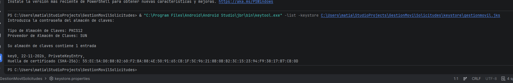
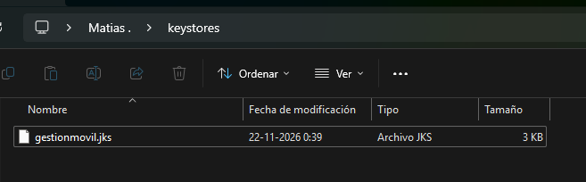

# Gestión móvil y seguimiento de solicitudes de clientes

Aplicación Android desarrollada para la asignatura **DSY1105 – Desarrollo de Aplicaciones Móviles** (Duoc UC, sede Puente Alto), basada en el caso *"Gestión móvil y seguimiento de solicitudes de clientes"* (005D).

Una pequeña empresa de servicios informáticos recibe hoy los requerimientos de sus clientes por WhatsApp, lo que dificulta saber qué solicitudes están pendientes, quién las atiende y en qué estado van. La app representa cómo una solicitud puede quedar **registrada, clasificada, asignada, seguida y cerrada** con trazabilidad completa. No se integra con WhatsApp: se comparte una referencia estructurada mediante el menú *Compartir* de Android.

> Proyecto académico (MVP). Usa únicamente **datos ficticios**: usuarios, clientes, solicitudes y fotos de prueba.

El repositorio contiene **dos partes** que trabajan juntas:

| Parte | Carpeta | Tecnología |
|---|---|---|
| App Android | `app/` | Kotlin, Jetpack Compose, MVVM, Room y Retrofit |
| Backend (2 microservicios) | `backend/` | Spring Boot 3.5, Spring Data JPA, MySQL o H2 |

La app consume los microservicios con **Retrofit** y una **API externa pública** (indicadores económicos de Chile). Room queda como caché local de lo que responde el servidor.

## Integrantes

| Nombre | Aporte principal                                                                                                                            |
|---|---------------------------------------------------------------------------------------------------------------------------------------------|
| Matias Figueroa | Capa de datos con Room, repositorio, login, menú, lista, formulario, detalle, paneles del administrador y del técnico, compartir referencia |
| Diego Nuñez | Integración de la cámara (Coil, FileProvider y captura de foto de evidencia) , informe y trello                                             |

- **Docente:** Vicente Julio Zapata Valenzuela
- **Asignatura:** DSY1105 – Desarrollo de Aplicaciones Móviles

## Funcionalidades implementadas

### Todos los perfiles
- Inicio de sesión con cuentas ficticias, identificación del perfil, control de acceso y cierre de sesión.
- Lista de solicitudes con código, título, categoría y estado (cada estado con su color).
- Detalle de la solicitud: estado vigente, prioridad, última actualización, datos, descripción, foto de evidencia e **historial cronológico** (fecha, hora, acción, cambio de estado, comentario y usuario).
- Comentarios en la solicitud mientras no esté cerrada o cancelada.
- **Compartir referencia**: mensaje estructurado con código, título, categoría y un enlace de seguimiento ficticio (sin descripción ni datos del cliente).
- **Notificaciones locales** con permiso del usuario: avisos de cambios de estado, asignaciones, prioridad, comentarios y solicitudes atrasadas. Cada perfil recibe además, al iniciar sesión, las novedades que otros hicieron en sus solicitudes desde su última sesión.

### Cliente
- Crear solicitudes con título, descripción, categoría, servicio relacionado y sitio o activo relacionado (opcional), con validaciones visibles por campo.
- Adjuntar una **foto de evidencia** con la cámara del dispositivo y verla al consultar la solicitud.
- Código único (`SOL-AAAA-NNNN`), fecha y hora de creación y estado inicial *Recibida*.
- Editar sus solicitudes mientras no estén cerradas o canceladas.
- Responder las solicitudes de información, **confirmar la resolución** o **solicitar la reapertura**.
- Solo ve sus propias solicitudes.

### Administrador
- Ve todas las solicitudes.
- Define la **prioridad**, **asigna o reasigna** el responsable, cambia el estado según las reglas y cancela con motivo.
- **Elimina solicitudes** desde el detalle, con confirmación previa; su historial y evidencias se eliminan con ella. Solo el administrador puede hacerlo.
- **Panel del administrador:** total de solicitudes, atrasadas (más de 7 días sin resolver), cantidad por estado, por prioridad y por responsable, y filtros por texto, estado, prioridad, cliente, responsable y solo atrasadas.

### Técnico
- Ve únicamente las solicitudes que tiene asignadas.
- **Panel del técnico:** indicadores, lista ordenada (las más urgentes primero) y su actividad reciente.
- Inicia el trabajo, registra avances, pide información al cliente y registra la solución para resolver.

### Integración con el backend y la API externa
- El inicio de sesión se valida en el microservicio de usuarios (`POST /api/auth/login`): una clave incorrecta devuelve 401 y la app muestra el mensaje.
- Crear, editar, **eliminar**, cambiar estado, asignar, comentar y registrar avances se envían al microservicio de solicitudes. El servidor aplica las reglas de acceso por perfil (por ejemplo, un cliente recibe 403 si intenta cambiar la prioridad o eliminar).
- El código de seguimiento (`SOL-AAAA-NNNN`) y el historial los genera el servidor.
- Si el servidor no responde, la lista muestra un aviso de "sin conexión" y usa los datos guardados en Room. El botón **Actualizar** vuelve a descargarlos.
- **API externa:** el menú muestra los indicadores económicos del día (UF, dólar, euro y UTM) desde `mindicador.cl`, consumidos con Retrofit sin interferir con los datos propios.

## Interfaz y experiencia de usuario

- **Formularios validados con íconos y mensajes por campo:** inicio de sesión, nueva solicitud y edición, comentarios, buscador y cuadros de texto de las acciones (reapertura, respuesta, avance, solución). Cada campo muestra su ícono, se marca en rojo con un ícono de advertencia y despliega el mensaje de error debajo. Todos usan un mismo componente reutilizable (`CampoFormulario`).
- **Validaciones desacopladas de la interfaz:** las reglas viven en `domain` (`ValidadorSolicitud`, `ValidadorLogin`, `ValidadorTexto`) y los `ViewModel` publican los errores en el `UiState`.
- **Animaciones funcionales:**
  - Transiciones entre pantallas (deslizamiento con fundido).
  - Mensajes de error que aparecen y desaparecen suavemente.
  - Indicador de progreso dentro de los botones *Ingresar* y *Guardar*.
  - Chip de estado que cambia de color y de texto con una transición.
  - Tarjetas de listas e historial que se reacomodan al cambiar los datos, y tarjetas del detalle que crecen o se encogen.
  - Contadores de los paneles que "cuentan" hasta su valor.
- Cada estado de la solicitud tiene su propio color, y la interfaz respeta el tema claro y oscuro del dispositivo.

## Reglas de negocio

Estados: *Recibida → En revisión → Pendiente de información → Asignada → En proceso → Resuelta → Cerrada / Cancelada*.

- Cada perfil solo puede realizar las transiciones de estado que le corresponden (`ReglasEstado`).
- El cliente no puede cerrar una solicitud por su cuenta: cierra confirmando una resolución.
- Todo cambio de estado, prioridad o responsable queda en el historial con fecha, hora, usuario y perfil.
- Una solicitud está **atrasada** si sigue sin resolverse a los 7 días de su creación (`ReglasAtraso`).

## Arquitectura

Patrón **MVVM**. Las pantallas solo muestran un `UiState` expuesto como `StateFlow` y notifican eventos al `ViewModel`; la validación y las reglas de negocio no viven en la interfaz.

```
Pantalla (Compose) -> ViewModel (UiState + StateFlow) -> Repository
                                                           |-- Retrofit --HTTP--> microservicios Spring Boot --> MySQL / H2
                                                           |-- Retrofit --HTTPS-> mindicador.cl (API externa)
                                                           '-- DAO --> Room (SQLite, caché local)
```

- Las **escrituras** van al servidor; con su respuesta se actualiza Room.
- Las **pantallas observan Room** (`Flow`), así que se refrescan solas cuando llegan los datos.
- La app llega al backend con `10.0.2.2` (el computador visto desde el emulador). Las URLs están en `app/build.gradle.kts`.

Backend (`backend/`), cada microservicio con su propia base de datos:

```
backend/
├── usuarios-service/      puerto 8081: login, usuarios (perfiles) y clientes
└── solicitudes-service/   puerto 8082: solicitudes, historial, reglas de estado y estadísticas
                           (consulta a usuarios-service para saber quién hace cada petición)
```

Cada petición a solicitudes-service lleva la cabecera `X-Usuario-Id`; el servidor consulta el perfil de ese usuario y decide qué puede ver y hacer.

```
app/src/main/java/com/example/gestionmovilsolicitudes/
├── data/
│   ├── dao/            consultas Room (SolicitudDao, HistorialDao, ...)
│   ├── entity/         tablas: usuarios, clientes, solicitudes, historial, evidencias
│   ├── repository/     SolicitudRepository (reglas de acceso y transacciones)
│   ├── AppDatabase.kt
│   ├── remote/         Retrofit: ApiClient, UsuariosApi, SolicitudesApi, DTOs y mapeos
│   │   └── externa/    IndicadoresApi (mindicador.cl)
│   └── SeedData.kt     datos de demostración locales (ya no se usan: los siembra el backend)
├── domain/             reglas puras: ValidadorSolicitud, ValidadorLogin, ValidadorTexto, ReglasEstado,
│                       ReglasAtraso, ReglasNotificacion, MensajeSeguimiento
├── model/              enums: Categoria, EstadoSolicitud, Prioridad, Perfil
├── notificaciones/     Notificador (canal, permiso y avisos) y UltimaConexion
├── session/            SessionManager (usuario conectado)
├── ui/
│   ├── login/  menu/  solicitud/  admin/  tecnico/  indicadores/
│   ├── componentes/    CampoFormulario, ErrorAnimado, ContadorAnimado (reutilizables)
│   ├── navigation/     AppNavigation (rutas y transiciones)
│   └── theme/
├── GestionApp.kt       Application: base de datos, repositorio y datos de prueba
└── MainActivity.kt
```

## Tecnologías

| Componente | Versión |
|---|---|
| Lenguaje | Kotlin 2.2.10 |
| Interfaz | Jetpack Compose y Material Design 3 (BOM 2026.02.01) |
| Navegación | Navigation Compose 2.10.2 |
| Estado | ViewModel 2.11.0, StateFlow y corrutinas 1.10.2 |
| Persistencia local (caché) | Room 2.8.5 (con KSP) |
| Red | Retrofit 3.0.0, convertidor Gson y OkHttp 4.12.0 (logging) |
| Backend | Java 17, Spring Boot 3.5.7, Spring Data JPA, Bean Validation, Swagger (springdoc) |
| Base de datos del backend | MySQL (por defecto) o H2 en archivo (perfil `h2`, sin instalar nada) |
| Imágenes | Coil 3.1.0 |
| Build | Android Gradle Plugin 9.4.1 y Gradle 9.6.0 |
| Plataforma | Android, `minSdk` 24 y `targetSdk` 37 |

**Recursos nativos del dispositivo:**

| Recurso | Uso en la app |
|---|---|
| Cámara | Captura de la foto de evidencia de la solicitud (`TakePicture` con `FileProvider`, almacenada en la carpeta interna de la app) |
| Notificaciones locales | Avisos de cambios en las solicitudes. Desde Android 13 se solicita el permiso `POST_NOTIFICATIONS` en tiempo de ejecución, con una explicación y un botón en el menú; si el usuario lo rechaza, la app sigue funcionando |
| Menú *Compartir* | Envío de la referencia estructurada de una solicitud |

## Cómo ejecutar el proyecto

La app necesita el backend encendido: **primero se levantan los microservicios y después se abre la app**.

### 1. Clonar el repositorio

```bash
git clone https://github.com/matiasfigueroami/GestionMovilSolicitudes.git
```

### 2. Levantar el backend (`backend/`)

Requiere **Java 17 o superior**. Se puede usar sin instalar MySQL con el perfil `h2`, que guarda la base en un archivo local (`backend/<servicio>/data/`).

**Opción A: IntelliJ IDEA (recomendada)**
1. Abrir la carpeta `backend/` (el `pom.xml` se reconoce como proyecto Maven).
2. Ejecutar **primero** `UsuariosServiceApplication` (puerto 8081) y **después** `SolicitudesServiceApplication` (puerto 8082).
3. En *Edit Configurations*, escribir `h2` en **Active profiles** de ambas. La consola debe decir `The following 1 profile is active: "h2"` y terminar con `Started ...Application`.

**Opción B: terminal** (requiere Maven), dentro de `backend/`:
```bash
mvn -pl usuarios-service spring-boot:run -Dspring-boot.run.profiles=h2
mvn -pl solicitudes-service spring-boot:run -Dspring-boot.run.profiles=h2   # en otra terminal
```

**Con MySQL** en lugar de H2: encender MySQL en el puerto 3306 y ejecutar sin perfil (las bases `gestion_usuarios` y `gestion_solicitudes` se crean solas; usuario `root` sin clave, configurable con `DB_USER` y `DB_PASSWORD`).

Comprobar que responde:
```bash
curl -X POST http://localhost:8081/api/auth/login -H "Content-Type: application/json" -d '{"correo":"admin@demo.cl","password":"1234"}'
```
Documentación Swagger: http://localhost:8081/swagger-ui.html y http://localhost:8082/swagger-ui.html. Consola H2 (solo perfil `h2`): `http://localhost:8082/h2-console` con JDBC URL `jdbc:h2:file:./data/gestion_solicitudes`, usuario `sa` y sin contraseña.

> En el primer arranque se cargan los datos de demostración. `usuarios-service` debe arrancar primero y sobre una base vacía: si se borra una base, hay que borrar también la otra (carpetas `data/`).

### 3. Ejecutar la app

1. Instalar una versión reciente de **Android Studio** compatible con Android Gradle Plugin 9.4.1 (incluye el JDK necesario).
2. Abrir la carpeta raíz del repositorio (no `backend/`) y esperar a que termine la sincronización de Gradle (**Sync Now**, requiere internet la primera vez).
3. Crear o elegir un emulador (por ejemplo, Pixel 7 con una imagen reciente de Android).
4. Presionar **Run ▶**.

La app llega al backend por `http://10.0.2.2:8081/` y `http://10.0.2.2:8082/`. Con un **teléfono físico** en la misma red Wi-Fi, cambiar esas dos URLs en `app/build.gradle.kts` por la IP del computador (por ejemplo `http://192.168.1.20:8081/`) y permitir los puertos en el firewall de Windows.

Para ver las peticiones de Retrofit: **Logcat** con el filtro `okhttp`.

> Si se necesita partir de cero, desinstalar la app del emulador (se borra la caché de Room).

### Cuentas de demostración

Datos ficticios que carga el backend al iniciar. Contraseña de todas las cuentas: `1234`.

| Perfil | Correo |
|---|---|
| Administrador | `admin@demo.cl` |
| Técnico | `tecnico1@demo.cl` y `tecnico2@demo.cl` |
| Cliente | `cliente1@demo.cl` y `cliente2@demo.cl` |

### Flujo sugerido para la demostración
1. **Preparación de las notificaciones:** entrar una vez con cada perfil y, en el menú, tocar **Activar notificaciones** y aceptar el permiso. La primera sesión de cada usuario solo registra su hora; los avisos llegan por lo que otros hagan después.
2. **Cliente** (`cliente1@demo.cl`): crear una solicitud con foto de evidencia.
3. **Administrador**: definir la prioridad y asignarla a un técnico.
4. **Técnico**: iniciar el trabajo, registrar un avance y registrar la solución.
5. **Cliente**: confirmar la resolución. La solicitud queda *Cerrada* y el historial muestra todo el recorrido.

Al cambiar de perfil, cada usuario ve en la barra de notificaciones las novedades de sus solicitudes.

### Notas sobre el emulador
- Las notificaciones requieren un emulador o teléfono con **Android 13 o superior** para que aparezca el diálogo de permiso.
- La cámara del emulador muestra una escena virtual: es lo esperado.
- Las horas se muestran según la zona horaria del dispositivo. Si el emulador está en GMT, configurarlo en *Santiago (Chile)* para ver la hora local.

## Endpoints utilizados

### API externa (consumida por la app con Retrofit)

| Método | URL | Descripción |
|---|---|---|
| GET | `https://mindicador.cl/api` | Indicadores económicos de Chile del día (UF, dólar, euro, UTM). Se muestran en el menú principal |

### Microservicio de usuarios (puerto 8081)

| Método | Ruta | Descripción |
|---|---|---|
| POST | `/api/auth/login` | Inicio de sesión `{correo, password}` → usuario (401 si no coincide) |
| GET | `/api/usuarios?perfil=TECNICO` | Lista de usuarios (filtro opcional por perfil) |
| GET | `/api/usuarios/{id}` | Un usuario |
| POST | `/api/usuarios` | Crear usuario |
| PUT | `/api/usuarios/{id}` | Editar usuario (contraseña vacía = mantener) |
| DELETE | `/api/usuarios/{id}` | Eliminar usuario |
| GET / POST | `/api/clientes` | Listar / crear clientes |
| GET / PUT / DELETE | `/api/clientes/{id}` | Ver / editar / eliminar cliente |

### Microservicio de solicitudes (puerto 8082)

Todas las rutas llevan la cabecera `X-Usuario-Id`.

| Método | Ruta | Quién | Descripción |
|---|---|---|---|
| GET | `/api/solicitudes` | Todos | Solicitudes visibles para el perfil. Filtros: `estado`, `prioridad`, `clienteId`, `responsableId`, `texto` |
| GET | `/api/solicitudes/{id}` | Con acceso | Detalle |
| POST | `/api/solicitudes` | Cliente | Crear (genera el código `SOL-AAAA-NNNN` y el estado *Recibida*) |
| PUT | `/api/solicitudes/{id}` | Cliente / Admin | Editar (no si está cerrada o cancelada) |
| DELETE | `/api/solicitudes/{id}` | Admin | Eliminar con su historial |
| PATCH | `/api/solicitudes/{id}/estado` | Según reglas | `{estado, comentario, accion}` |
| PATCH | `/api/solicitudes/{id}/prioridad` | Admin | `{prioridad}` |
| PATCH | `/api/solicitudes/{id}/responsable` | Admin | `{tecnicoId}` (valida contra usuarios-service que sea técnico) |
| POST | `/api/solicitudes/{id}/avances` | Técnico | `{texto}` (solo en proceso) |
| POST | `/api/solicitudes/{id}/comentarios` | Con acceso | `{texto}` |
| GET | `/api/solicitudes/{id}/historial` | Con acceso | Historial cronológico |
| GET | `/api/historial` | Todos | Historial de todas sus solicitudes visibles |
| GET | `/api/solicitudes/estadisticas` | Admin | Total, atrasadas, por estado, prioridad y responsable |

Los errores responden JSON `{ "estado": 409, "mensaje": "...", "timestamp": ... }` y la app muestra el `mensaje` tal cual. Más detalle en [`backend/README.md`](backend/README.md).

## APK firmado y llave (.jks)

El APK release se firma con una llave propia. La configuración está en `app/build.gradle.kts` (bloque `signingConfigs`), que lee los datos desde `keystore.properties` en la raíz del proyecto.

| Elemento | Ubicación |
|---|---|
| Llave de firma (`.jks`) | `keystore/gestionmovil.jks` |
| Configuración de la firma | `keystore.properties` y `app/build.gradle.kts` |
| APK firmado | `app/release/app-release.apk` |

> La llave se incluye en el repositorio solo porque la entrega académica lo exige. Es una llave de pruebas y no debe usarse para publicar aplicaciones reales.

Generar el APK firmado desde la terminal:
```bash
./gradlew assembleRelease
```
Queda en `app/build/outputs/apk/release/app-release.apk`. También se puede generar con **Build → Generate Signed App Bundle / APK**.

Comprobar la firma:
```bash
apksigner verify --print-certs app/release/app-release.apk
```

### Capturas

**APK firmado**



**Llave `.jks`**



## Pruebas

Las pruebas están separadas según lo que verifican:

**Pruebas unitarias de lógica** (`app/src/test`, se ejecutan en el computador, sin emulador). Verifican las **validaciones** del dominio:

| Archivo | Qué comprueba |
|---|---|
| `ValidadorSolicitudTest` | Un formulario de solicitud vacío marca como obligatorios el título, la descripción y la categoría |
| `ValidadorLoginTest` | El inicio de sesión con los campos vacíos genera un error por campo (correo y contraseña) |

```bash
./gradlew testDebugUnitTest
```

**Pruebas del backend** (`backend/solicitudes-service/src/test`, JUnit). Verifican las reglas de negocio del servidor (`ReglasNegocioTest`):

```bash
cd backend
mvn test
```

**Pruebas instrumentadas de la vista** (`app/src/androidTest`, se ejecutan en un emulador o teléfono). Verifican lo que se ve en pantalla con Compose:

| Archivo | Qué comprueba |
|---|---|
| `CampoFormularioTest` | El campo de formulario muestra su etiqueta y el mensaje de error |
| `EstadoChipTest` | El chip de la solicitud muestra el nombre del estado (*Recibida*) |

```bash
./gradlew connectedDebugAndroidTest
```

## Próximos pasos
- Evidencias adicionales adjuntadas por el técnico.
- Comentarios internos que el cliente no pueda ver.
- Exportación de información ficticia y medición simulada de tiempos (complementos del caso).
